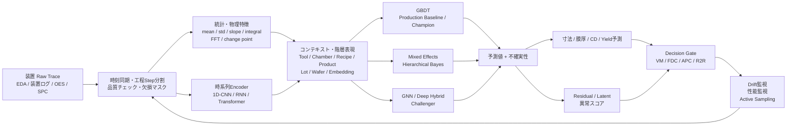
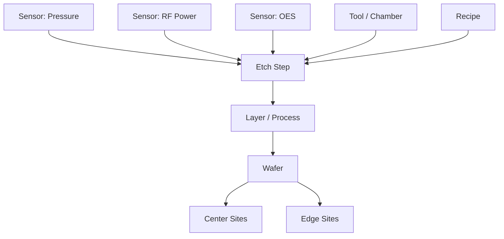

# 半導体製造の高次元・階層・時系列データに対する予測モデル構築手法

## エグゼクティブサマリ

半導体製造装置では、エッチング、成膜、CMP、リソグラフィ等の装置から多数のセンシングチャネルが連続的に生成され、SEMIも現在のスマートファブを「多数の装置・センサから高頻度データを収集し、FDC、APC、歩留まり改善等へ利用する環境」と位置付けている。SEMIのEDA（Equipment Data Acquisition、Interface A）標準群は高速・多クライアントの装置データ取得を想定し、データ品質についてもSEMI E151/E160などが整備されている。近年の装置では圧力、流量、RF power、光学信号、振動、化学系信号など多種類のセンシングチャネルが存在する。 citeturn13search0turn13search12turn16search3

本問題の本質は、単純な「大量の変数を入力した回帰」ではない。入力 \(X\) は**高次元多変量時系列**、出力 \(Y\) はチップ・ウェハ・ロット等で観測される**異なる粒度の品質指標**、さらに装置・チャンバ・レシピ・製品・ロットによる群間差、経時ドリフト、欠測、計測サンプリングによるラベル欠損が同時に存在する。Virtual Metrology（VM）はまさに、装置・プロセス情報から実測前に膜厚や寸法等を推定するアプローチであり、国内でも半導体工場でのVM活用が報告されている。近年は装置時系列から膜厚を予測するGNN、マルチモーダル階層学習、少数サンプル適応まで研究対象が広がっている。 citeturn12search0turn10search2turn4search4turn17search0turn17search5

**最も実用性が高い設計は、一つの巨大モデルですべてを解くことではなく、複数モデルを階層化したハイブリッド構成である。** 特に初期の本番モデルとしては、

> **工程ステップ整列 → 時系列特徴量＋コンテキスト特徴量 → GBDT → 階層別補正・不確実性推定 → residual/latent anomaly detection**

を第一候補とすることを推奨する。GBDTは表形式データで依然として非常に強いベースラインであり、広範なベンチマークでは深層学習との優劣がデータセット・チューニングに強く依存する。したがって、最初からTransformerへ一本化するより、LightGBM/CatBoost等を基準モデルに置き、CNN/Transformer/GNNをchallengerとして比較する方がリスクが低い。 citeturn1search8turn1search0turn1search12turn1search2turn1search3

ただし、生波形そのものに局所的な形状情報が含まれる場合は1D-CNN、長い時間依存が重要ならTransformer、工程・センサ・層・ウェハ位置間に明示的な関係がある場合はGNNが有力になる。2026年のASU・Intel Foundryによる成膜VM研究では、step–parameter pairをノード化し、CNNによる時間特徴とGraph Attentionを組み合わせて膜厚を予測する構成が報告されており、半導体データにおける「時系列＋グラフ」の有力な具体例である。 citeturn3search3turn3search15turn3search2turn4search4

階層性については、**完全プーリングでも完全分離でもなくpartial poolingを使う**ことが重要である。例えば装置・チャンバごとにモデルを完全に別にすると少数データ群で過学習しやすく、全装置を同一モデルで扱うとtool-to-tool差を吸収できない。混合効果モデルや階層ベイズは、この中間をデータから推定できる。 citeturn2search0turn2search1turn2search2

さらに、工場内で実際に管理すべき階層は「装置→ロット→ウェハ→チップ」という単純な木だけではない。ウェハは工程ごとに異なる装置・チャンバ・レシピを通るため、全工程を対象にすると**nested hierarchyとcrossed/grouped structureの混在**として扱う方が自然である。装置、チャンバ、レシピ、製品、工程、ロットを独立したrandom effectまたはembeddingとして表現する設計が有効である。これは混合効果モデルがcrossed random effectsを扱えること、およびSEMIが工程・基板・装置コンテキストを明示的に追跡する標準を整備していることとも整合する。 citeturn2search2turn13search0

最終的な推奨アーキテクチャは次の通りである。

この構造は、SEMIが整理するEDA/FDC/APC/R2Rの利用形態とも一致し、VMを単なる予測器ではなく、計測、異常検知、工程制御への入力として位置付けられる。 citeturn13search0turn13search2turn13search3turn13search13

## データ特性と問題定式化

半導体製造でモデル精度を左右する最大の要因は、アルゴリズム以前に**「何を一つのサンプルと定義するか」**である。センサログを1時点＝1サンプルとして学習すると、同一ウェハ内の大量の近接時点をtrain/test双方へ混入させやすく、検証精度を著しく楽観化する。品質予測では、基本的にはprocess run、wafer、site/chip等をサンプル単位として定義し、その下に時系列をぶら下げる構造が望ましい。SEMIのEDA/FDCでもイベントや工程コンテキストに対応付けたデータ取得・framingが重要視されている。 citeturn13search2turn13search3

| 特性 | 半導体製造での典型的な形 | モデル上の扱い |
|---|---|---|
| 階層 | Fab/装置・チャンバ → Lot → Wafer → Chip/Site。ただし工程横断では装置・レシピがcrossed | random effect、hierarchical prior、embedding、GNN |
| 時系列 | wafer処理中のsensor trace、wafer-to-wafer、lot-to-lot、長期tool aging | step alignment、lag/rolling特徴、CNN/RNN/Transformer、state-space |
| センサ | pressure、gas flow、temperature、RF、OES等。装置により構成が異なる | センサfamily単位の特徴量、mask、クラスタリング |
| サンプリング | 固定周期とイベント駆動が混在。信号・装置により周期が異なる | original timestamp保持、必要なモデル入力のみresampling |
| 欠損 | 通信欠損、センサ停止、工程上存在しないstructural missing、計測省略 | 一律補間しない。mask/欠損理由/native missing |
| ノイズ | spike、offset、calibration差、sensor drift、tool matching差 | robust scaling、Hampel等、change detection、tool context保持 |
| ラベル | 全ウェハではなく抽出計測になりやすい。寸法は連続値、良否はbinary、yieldは集約値 | VM、semi/self-supervised、multi-task、uncertainty |
| 空間 | wafer上site/chip座標、中心/edge差、2D defect map | XY特徴、CNN/GNN/spatial basis |

エッチングの近年のデータセット例では、RF power、gas flow、pressure、temperature、複数波長のOESが多変量時系列として記録され、ウェハ上89点のetch depthを予測対象としている。これは「多変量時系列→ウェハ空間上の多点連続値」という、単純な表形式回帰を超える典型例である。 citeturn16search1turn17search7

**欠損は少なくとも三種類に分離すべきである。**

第一は、通信障害等による偶発的な欠損。第二は「その工程Stepではそのセンサが意味を持たない」というstructural missing。第三は、ウェハを実測しなかったために目的変数自体が欠損するlabel missingである。これらを同一の平均補完で処理すると情報を失う。大量生産CVDのVM研究でも多数特徴と欠損を含む製造データが扱われており、半導体VMにおいて欠測処理自体が研究テーマとなっている。CatBoostのように欠損値をモデル内部で扱える手法も有効である。 citeturn0search23turn1search3

入力を

\[
X_{r,t,s}
\]

とし、\(r\) をprocess run、\(t\) を時刻、\(s\) をsensorとする。連続品質値であれば、概念上は

\[
y_{e,l,w,c}
=
f_\theta(X)
+u_e+u_{\mathrm{chamber}}+u_{\mathrm{recipe}}
+u_l+u_w+\epsilon
\]

のように、「共通の非線形関数 \(f_\theta\)」と装置・ロット等の群効果を分ける定式化が有効である。混合効果モデルや階層ベイズでは、この群効果にpartial poolingを導入できる。 citeturn2search0turn2search1turn2search22

歩留まりについてはさらに注意が必要である。チップ単位なら、

\[
g_c\sim\mathrm{Bernoulli}(p_c),\qquad
\mathrm{logit}(p_c)=f_\theta(X_c)+u_{\mathrm{wafer}}+u_{\mathrm{lot}}+\cdots
\]

とモデル化でき、ウェハ歩留まりは

\[
Y_{\mathrm{wafer}}
=
\frac{\sum_c g_c}{N_{\mathrm{tested}}}
\]

として導ける。したがって、**ウェハ歩留まり60%という一個のラベルを、そのウェハの全chipや全sensor時点へ複製して通常の教師あり学習を行うのは避けるべき**である。同一ラベルの疑似反復を増やすだけで、有効サンプル数が増えたわけではない。評価splitもwafer/lot単位で分離する必要がある。grouped cross-validationが必要になる理由もここにある。 citeturn7search24turn7search0

また、toolごとのz-score標準化だけを保存する設計にも注意が必要である。tool間offsetが品質変動原因なら、それを標準化で消してしまうためである。**raw値、tool内normalization値、tool ID、calibration情報を併存させる**方が原因解析との整合性が高い。

## 候補手法の体系的比較

以下の「推奨度」は、本件のような**多数センサ＋階層＋時系列＋連続品質/歩留まり**という条件を前提にした相対評価である。

| 手法 | 主な利点 | 主な欠点 | 適用条件・本件での位置付け |
|---|---|---|---|
| **混合効果モデル** | 装置・ロット・ウェハ差をfixed/random effectに分解。解釈しやすくpartial pooling可能 | 強い非線形・巨大センサ時系列を直接扱うには不足 | **有力な補正層・baseline**。GBDT/NNとのハイブリッドにも適する。statsmodels MixedLMはnested/crossed構造を扱える。 citeturn2search2turn2search22 |
| **マルチレベルモデル** | 階層ごとの分散を明示化し、群間差と個体差を分離 | 「手法」というよりモデル設計概念で実装方式を別途選ぶ必要 | tool→lot→wafer→chip等の基本的定式化として**強く推奨**。 citeturn2search0turn2search8 |
| **階層ベイズ** | partial pooling、不確実性、少数データtoolへの情報共有が自然 | 巨大データ・巨大潜在変数でMCMCが重い | **少数データ群、不確実性が重要なAPC、校正モデルに有力**。大規模時はVI等を検討。 citeturn2search1turn2search9 |
| **Random Forest等ツリー** | 非線形・interactionを容易に扱い、標準化不要 | GBDTより精度面で劣る場合があり、巨大木はメモリ増 | 良好なbenchmark、特徴選択・非線形性確認用 |
| **GBDT** | tabular特徴で極めて強い。欠損や非線形interactionへ強い | 生波形の長距離時系列表現は不得手 | **最優先production baseline/champion候補**。深層tabularとの比較研究でも強い基準。 citeturn1search8turn1search12turn1search2turn1search3 |
| **1D-CNN / TCN型** | 局所波形、立上り、overshoot、周期形状等を効率良く抽出。並列化容易 | 非常に長い依存関係は別設計が必要 | **生trace encoderの第一候補**。半導体GAT-VMでもCNN temporal embeddingが利用されている。 citeturn3search3turn4search4 |
| **RNN/LSTM** | 状態遷移の直感に合い、中程度の系列長に適する | sequential computationで学習並列性が低い | wafer内工程遷移、wafer-to-wafer sequenceに適用可能。 citeturn3search11 |
| **Transformer** | 長距離dependency、sensor間attention、可変長系列を表現可能 | 大量データ・計算量を要求。短い工程traceでは過剰になり得る | 長系列・大量事前学習データがある場合のchallenger。 citeturn3search15turn3search19 |
| **GNN** | sensor–step–layer、wafer site、tool-route等の関係をgraphとして組み込める | graph定義が難しく、構造が不適切なら利点が出ない | **物理・工程関係が明確な場合に非常に有望**。2026年の成膜VMでGraph Attention利用例。 citeturn3search2turn3search6turn4search4 |
| **自己教師あり学習** | ラベルなし大量traceでencoderを事前学習可能 | pretext taskと品質予測に乖離があると効果が限定的 | **計測ラベルが疎で生traceが豊富な本件と相性が良い**。contrastive/time representation研究が利用可能。 citeturn3search1turn3search9turn3search17 |
| **因果推論・因果探索** | 「予測するsensor」から「変更すべきprocess variable」への橋渡し | observational dataだけでは介入効果を保証できない | 工程最適化・root cause候補抽出で重要。PCMCI、PC/GES/LiNGAM等を候補にする。 citeturn6search0turn5search23turn5search3 |
| **Autoencoder** | unlabeled traceの低次元化とreconstruction anomaly detectionを同時に行える | anomalyまで再構成する場合があり、閾値設計が必要 | latent representation＋異常検知の補助モデルに有力 |
| **VAE** | 潜在分布とreconstruction likelihood等を異常度に利用可能 | 学習不安定性、posterior設計、異常の再構成問題 | multivariate time-series anomalyへ利用可能。 citeturn9search0turn9search8 |
| **One-Class SVM** | 正常データのみから境界形成 | 大規模・超高次元に不利、外れ値やパラメータ感度が高い | PCA/AE後の低次元データや小規模toolで使用。 citeturn5search4turn9search10 |
| **Isolation Forest** | 非教師異常検知として軽量、強いbaseline | 時系列構造をそのまま理解しない | 集約特徴量ベースのFDC baselineとして有力。 citeturn9search2 |
| **オンライン学習** | tool driftやrecipe changeに逐次適応可能 | 誤ったfeedbackでモデル自体がドリフトする危険 | **監視付き適応として推奨**。Riverはオンライン学習とdrift detectorを提供する。 citeturn7search5turn7search1 |
| **メタラーニング / Few-shot** | 新tool・recipe・productへの少数データ適応 | task定義が不適切だとnegative transfer | 将来的に有望。2025年にはfew-shot fine-tuningを使う半導体VM/APC研究が報告されている。 citeturn17search0turn17search13 |

実務では、これらを「どれか一つ」に決める必要はない。例えば、

\[
\text{1D-CNN encoder}
\rightarrow
\text{embedding}
\rightarrow
\text{GBDT}
\]

や、

\[
\text{Transformer encoder}
+
\text{tool random effect}
\rightarrow
\text{quality prediction}
\]

のような**deep feature＋tabular model**、**deep model＋hierarchical correction**という組合せが合理的である。

特にGBDTについては、「深層学習より古いので外す」という判断をしてはいけない。大規模なtabular benchmarkではGBDTとNNの優劣は一律ではなく、GBDTのチューニングが重要である一方、近年のMLP/Transformer系が十分に調整されると競争力を示すという結果もある。したがって本件では**CatBoost/LightGBMクラスのGBDTを必ずbenchmarkに残す**べきである。 citeturn1search8turn1search0turn1search12

## 高次元・階層・時系列を統合するモデル設計

高次元対策で最も重要なのは、「いきなりPCAですべてを圧縮する」のではなく、**工程知識による意味的分割→信号品質管理→時間特徴抽出→統計的選択→必要なら非線形表現学習**という順序にすることである。

推奨する特徴量は、各sensor × process stepに対して

\[
\{\mathrm{mean},\ \mathrm{std},\ \min,\ \max,\ 
q_{10},q_{50},q_{90},\
\mathrm{slope},\
\mathrm{integral},\
\mathrm{range},\
\mathrm{time\ in\ spec}\}
\]

を基本とし、必要に応じてFFT/wavelet energy、autocorrelation、change point、peak count、立上り時間、overshoot、前ウェハとの差、rolling mean/std、lot内position等を追加する。こうして10万～100万次元相当のraw traceを数百～数千の意味のある特徴へ圧縮し、GBDTを構築する。さらにraw waveform encoderを並行して学習させる「二経路構成」が実用上強い。

高次元特徴の選択は、**missing ratio/定数特徴の除去 → domain screening → correlation/cluster → sparse/stability selection → model-based importance**の順に行うとよい。scikit-learnはunivariate selection、recursive feature elimination等を提供し、statsmodelsには一部モデルでL1正則化もある。 citeturn5search24turn2search26

次元削減手法の役割は明確に区別すべきである。

| 方法 | 推奨用途 | 注意点 |
|---|---|---|
| **PCA** | 強い共線性を持つsensor群の圧縮、可視化、OCSVM等の前処理 | 線形であり、物理的解釈を失いやすい。特徴数が非常に多い場合はsolverごとのメモリ特性にも注意。 citeturn5search0 |
| **UMAP** | lot/tool/recipe/anomaly clusterの探索的可視化 | 主生産モデルの唯一の入力表現とするよりEDA向き。supervised UMAPも存在する。 citeturn5search1turn5search9 |
| **Autoencoder** | 非線形圧縮、生trace embedding、anomaly detection | reconstruction accuracy≠品質予測能力 |
| **Sparse/L1** | 多数の弱い・冗長sensorの削減 | 強相関群では代表変数が不安定になり得る |
| **Embedding** | tool/chamber/recipe/product/sensor ID等の高cardinalityカテゴリ | 未知カテゴリへのfallback設計が必要 |
| **Sensor clustering** | 冗長センサ群、subsystem単位の整理、group SHAP | 相関のみでまとめず工程・物理情報も併用 |

**sensor clusteringは特に有効**である。例えば圧力系、gas-flow系、RF系、thermal系、OES波長群といった物理familyをまず定義し、その内部で相関・mutual information等を用いてクラスタ化する。SHAPも個別の数千sensorに対して表示するのではなく、sensor family × process stepで集約した方が工程エンジニアにとって解釈しやすい。

階層時系列については、「階層」を二種類に分ける必要がある。

一つは**予測対象の集計階層**であり、

\[
chip \rightarrow wafer \rightarrow lot
\]

のように下位予測を上位へ集計できる。この種のhierarchical forecastingでは、各levelの予測を整合させるforecast reconciliationが研究されており、MinT等の方法が代表的である。 citeturn14search0turn14search1turn14search3

ただしyield率は単純な加算量ではないため、

\[
Y_l=\sum_i Y_i
\]

のような通常のhierarchical reconciliationを直接適用してはいけない。**good-chip countとtested-chip countを別々に集約して最後に比率を計算する**か、適切なbinomialモデルで整合性を確保する設計が望ましい。これは半導体歩留まりにhierarchical forecastingを適用する際の重要な実装上の違いである。

もう一つは**潜在process stateの時間階層**である。例えば、

\[
z_t=A z_{t-1}+Bu_t+\eta_t
\]

\[
y_t=Cz_t+\epsilon_t
\]

として、観測できないchamber state、wall condition、contamination、tool aging等をlatent stateとして扱う。この場合、state-space modelとKalman filter/smootherが有力であり、statsmodelsはstate-space/Kalman filterの実装を提供している。 citeturn2search7turn2search3

tool差も同時に扱うなら、

\[
A_e \sim \mathcal N(A_0,\Sigma_A)
\]

のようにstate transition parameterをtool間で階層化した**hierarchical Bayesian state-space model**が考えられる。これは「全tool共通モデル」と「tool別モデル」の中間を推定する考え方であり、階層ベイズのpartial pooling原理とstate-spaceを組み合わせたものになる。 citeturn2search1turn2search7

Kalman filterは線形・Gaussianに近い状態推定で非常に効率的であり、非線形性・非Gaussian性が強い場合にはparticle filter/Sequential Monte Carloを候補とする。Pyroの`SMCFilter`はsequential importance resamplingによるオンラインfilteringインターフェースを提供しており、計算量はparticle数と状態保持量に依存するため、大量sensorをそのまま状態変数にするのではなく低次元latent stateへ落とすのが現実的である。 citeturn15search0turn15search2

**hierarchical RNN**を構築する場合は、例えば、

\[
\text{sensor trace}
\xrightarrow{\mathrm{CNN/LSTM}}
h_{\mathrm{step}}
\xrightarrow{\mathrm{RNN}}
h_{\mathrm{wafer}}
\xrightarrow{\mathrm{attention/pooling}}
h_{\mathrm{lot}}
\]

という構造が考えられる。各工程stepをまず局所encoderで表現し、それを工程順にRNNへ入力することで、「短時間のsensor dynamics」と「長い工程trajectory」を分離できる。近年の半導体VMでは、時系列・マルチモーダル・階層表現を組み合わせる方向へ研究が進んでいる。 citeturn3search11turn17search5

GNNはさらに、次のような関係を明示できる。

PyTorch Geometricはheterogeneous graph dataおよび異種エッジごとのmessage passingをサポートしている。半導体VMでもstep–parameter pairをノードとして時間特徴をCNNで抽出し、Graph Attentionで工程構造を統合する研究が2026年に報告されているため、**GNNは「流行だから使う」のではなく、明示的な工程graphが定義できる場合に導入する**のが適切である。 citeturn3search2turn3search6turn3search26turn4search4

## 解釈性・因果性・異常検知

品質予測を工程最適化につなげる場合、**予測精度と原因推定を明確に区別することが最重要**である。SHAP値が大きいsensorを変更すれば歩留まりが上がる、とは限らない。

SHAPはゲーム理論的な特徴寄与分解であり、TreeSHAPはtree ensembleに対して効率的な計算を提供する。したがってGBDTの工程説明には非常に適している。一方で相関するsensor群では寄与が複数特徴へ分散するため、個別sensorだけでなく「RF family」「gas family」「step A」のようなgroup単位で解釈することを推奨する。 citeturn5search6turn5search2

LIMEは一つの予測点の周囲に局所的なinterpretable modelを構築する方法であり、異常ウェハ単位の説明には使いやすい。一方、説明結果がsamplingや局所近似に依存するため、量産工程の恒久的なroot-cause判定をLIME単独で行うのは避けるべきである。 citeturn6search3

Partial Dependence Plotは、指定したfeature値を変えたときのモデル平均応答を可視化する。しかし強く相関したセンサについて、実際には存在しないpressure–flow–RF組合せまで評価する可能性がある。そのため、PDPは工程操作量の因果効果ではなく**モデルの応答特性**として読むべきである。 citeturn6search2turn6search23

因果探索では、半導体プロセスの時間順序を事前制約として利用する価値が大きい。TigramiteのPCMCIは多変量時系列におけるlagged causal relationを対象とし、PCMCI+は同時刻関係も扱える。LPCMCIは潜在交絡を許す設定を扱い、J-PCMCI+は複数context/data setを利用する枠組みを提供する。 citeturn6search0turn6search8turn6search12

静的・工程集約データではPC、GES、LiNGAM等も候補になる。`causal-learn`はこれらの因果探索アルゴリズムを提供し、DoWhyからcausal-learnを呼び出す例も公式に提供されている。 citeturn5search3turn5search23

ただし、**因果探索で得られたedgeは最終的なprocess recipe変更指示ではない**。観測データでは、装置control loop、未観測chamber state、maintenance、recipe selection等による交絡があり得るためである。工程上あり得ない因果方向を禁止し、候補原因を絞った後、DOE、engineering test、意図的介入等で検証する構成が必要になる。Granger causalityについても、statsmodelsの定義通り「過去の系列が別系列の予測に追加情報を持つか」を検定するものであり、介入的因果効果と同一視すべきではない。 citeturn6search1

異常検知では、センサそのものの異常度と**品質予測残差**を組み合わせることを強く推奨する。

\[
r_i
=
y_i^{\mathrm{measured}}
-
\hat y_i^{\mathrm{VM}}
\]

をVM residualとし、

\[
A_i
=
\alpha |r_i|
+\beta A_i^{\mathrm{latent}}
+\gamma A_i^{\mathrm{sensor}}
\]

のように、品質残差、latent anomaly、sensor anomalyを統合する。この構成なら「sensorパターンは珍しいが品質は正常」と「sensorパターンは普通に見えるが品質が大きく外れた」を区別できる。

Autoencoder/VAEはラベルなしsensor traceを使える点が強く、VAEを多変量時系列異常検知に用いる研究も蓄積されている。一方で十分に表現力のあるdecoderが異常まで良く再構成する場合があるため、reconstruction errorだけに依存せず、latent likelihood、prediction residual、工程条件付き閾値を併用した方がよい。 citeturn9search0turn9search8

One-Class SVMは小規模・低次元では有効だが、scikit-learnのドキュメントでも外れ値に対する感度等に注意が必要である。本件のような多数sensorでは、PCA/AE後のembeddingに適用するか、Isolation Forestをより軽量なbaselineとして置く方が扱いやすい。 citeturn5search4turn9search10turn9search2

さらに、異常閾値を全工場で一つにすべきではない。正常分布自体が

\[
p(A\mid tool, chamber, recipe, product, step)
\]

で変化するため、**tool × recipe × process step条件付き閾値**、または階層モデルによるthreshold shrinkageを採用した方がfalse alarmを抑えやすい。

## 実装・スケーラビリティ・評価設計

大規模半導体データでは、MLアルゴリズム以上に**raw traceをどう保存し、学習データを再現可能にするか**が重要である。SEMIのEDAは大量の装置データを高頻度に利用する前提で設計されており、FDCではイベント・工程コンテキストに沿ったframingが誤警報低減やexcursion検知に重要とされている。 citeturn13search0turn13search1turn13search2

推奨するデータレイヤは次の三層である。

**Raw/bronze層**ではsensor traceを可能な限りimmutableに保存し、timestamp、tool、chamber、recipe、step、lot、wafer、event informationを保持する。

**Aligned/silver層**では、clock correction、process-step segmentation、mask、品質フラグ、unit normalization等を行う。

**Feature/gold層**では、

\[
(\text{process\_run\_id},\text{wafer\_id},\text{step\_id})
\]

を主キーとして、統計特徴、embedding、quality label、metadataを保存する。

特に特徴量を毎回raw dataから場当たり的に再計算すると、training-serving skewと再現性問題が起きやすいため、feature definition自体をversion管理すべきである。

深層学習ではモデルが単一GPUに収まるならPyTorch DistributedDataParallelで複数GPUへ学習を分散でき、モデル自体が単一GPUに入らない場合はsharded approaches等が必要になる。PyTorch公式ドキュメントもDDPをmulti-process gradient synchronizationの標準的手段として提供している。 citeturn7search2turn7search6turn7search14

一方、階層ベイズを数百万ウェハ・数千群へそのままfull MCMCで適用すると計算が支配的になりやすい。その場合は、推論対象をtool/chamber-level calibrationへ限定する、十分統計量へ圧縮する、variational inferenceを利用する、といった役割分担が合理的である。Stan/PyMCはいずれも階層モデルを主要なモデルクラスとして扱っている。 citeturn2search0turn2search1turn2search9

**リアルタイム推論**では、すべてのsensor traceにTransformerを逐次実行する必要はない。工程中は軽量FDC、工程終了時にGBDT/1D-CNN VM、計測後にhierarchical calibration、というようにlatency requirementでモデルを分ける方が運用しやすい。

オンライン適応にはRiver等のstreaming ML frameworkを利用でき、ADWIN、KSWIN、Page-Hinkley等のdrift detectorも利用できる。ADWINは可変長windowを利用するchange detectorであり、モデルを自動更新する前段のdrift monitoringとして有用である。 citeturn7search5turn7search1turn7search9

ただし半導体APCでは、**drift検知＝即時オンライン再学習**としない方が安全である。推奨順序は、

\[
\text{drift alert}
\rightarrow
\text{shadow retraining}
\rightarrow
\text{offline validation}
\rightarrow
\text{engineering approval}
\rightarrow
\text{canary}
\rightarrow
\text{production}
\]

である。モデル自身がprocess controlを変更し、その結果で自分を再学習する閉ループではfeedback biasが生じ得るからである。

MLflow Model Registryはmodel version、lineage、metadata等を管理でき、serving機能も提供するため、この種のshadow/canary/version rollback環境の構成要素として利用できる。 citeturn7search3turn7search23

**検証方法は通常のrandom K-foldを原則禁止と考えるべきである。** 時系列データで未来データがtrainingへ入るとlook-ahead leakageとなるため、scikit-learnもtime-ordered dataにはTimeSeriesSplitを提供している。また同一groupから強く相関したサンプルが発生する場合はGroupKFold/StratifiedGroupKFoldが適切である。 citeturn7search8turn7search24turn7search0

本件では次の多段評価を推奨する。

| 検証 | Split設計 | 評価したい能力 |
|---|---|---|
| 通常production評価 | 最後の期間を完全hold-out | 未来のproduction性能 |
| lot leakage防止 | lot単位でtrain/test分離 | 未知lotへの一般化 |
| wafer leakage防止 | wafer単位分離 | 同一wafer内相関の排除 |
| tool stress test | Leave-one-tool/chamber-out | 新toolへのtransfer |
| recipe stress test | Leave-one-recipe-out | recipe変更耐性 |
| product stress test | Leave-one-product-out | 新製品へのgeneralization |
| drift test | maintenance前後/時間block | chamber driftへの頑健性 |

最も厳密には、外側をtime split、

\[
D_{\mathrm{train}}:
t<t_0,\qquad
D_{\mathrm{test}}:
t\geq t_0
\]

とし、train内部のhyperparameter tuningをlot/wafer GroupKFoldで行う。さらに別途leave-tool-outをstress testとする。これは「同一装置の未来予測」と「新装置へのgeneralization」という異なる問題を混同しないためである。rolling forecast originも時系列評価の標準的な考え方である。 citeturn14search15turn7search24

連続値予測では、

\[
RMSE=
\sqrt{\frac1N\sum_i(y_i-\hat y_i)^2}
\]

と

\[
MAE=
\frac1N\sum_i|y_i-\hat y_i|
\]

を併用する。RMSEは大外れを強く罰し、MAEは典型誤差を解釈しやすい。平均だけではなく、**tool別・recipe別・product別・wafer position別のmacro error**も出すべきである。大規模toolのサンプル数が多い場合、micro平均だけでは小規模toolの性能劣化を隠すためである。

異常/不良分類ではAUC-ROCに加え、不良が希少ならPR-AUC、Recall at fixed false-positive rate、false alarms/1,000 wafers等を見る。運用上は「AUCが高い」より、**一日に何件false alarmを出しながら、実excursionの何%を何ウェハ早く捕捉できるか**の方が重要である。

最終的にはML指標より業務KPIで判断すべきである。推奨KPIは、

\[
\Delta Yield
=
Yield_{\mathrm{after}}
-
Yield_{\mathrm{before}}
\]

に加え、scrap reduction、rework reduction、metrology sampling reduction、excursion escape rate、平均検知lead time、false alarm rate、cycle-time impact、制御変更後の工程安定性である。SEMIもsmart manufacturingをyield、quality、productivity、FDC/APC/R2R等の文脈で整理している。 citeturn13search0turn13search13

## 推奨ワークフロー・実用事例・参考実装・参考文献

本件に対しては、以下の段階的な導入が最も成功確率が高い。

**データ契約を最初に固定する。** `tool_id / chamber_id / recipe_id / process_step / product_id / lot_id / wafer_id / chip_or_site_id / process_start / process_end / sensor_timestamp / maintenance_state`を最低限のjoin key/contextとして定義する。EDA等から取得するsensor traceとmeasurement/yield databaseの結合品質を、モデル開発前に評価する。SEMIのEDAおよびprocess/substrate tracking標準はこのようなコンテキスト付きデータ利用の基盤となる。 citeturn13search0turn13search12

**次にprocess-step alig